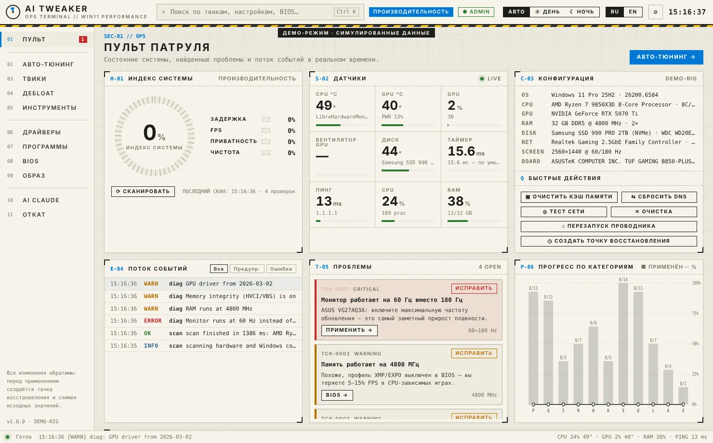
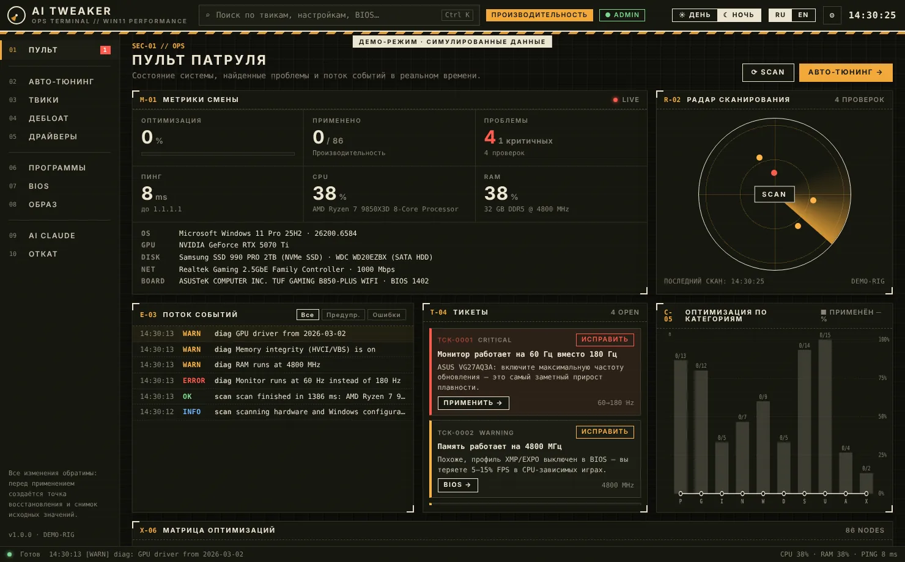
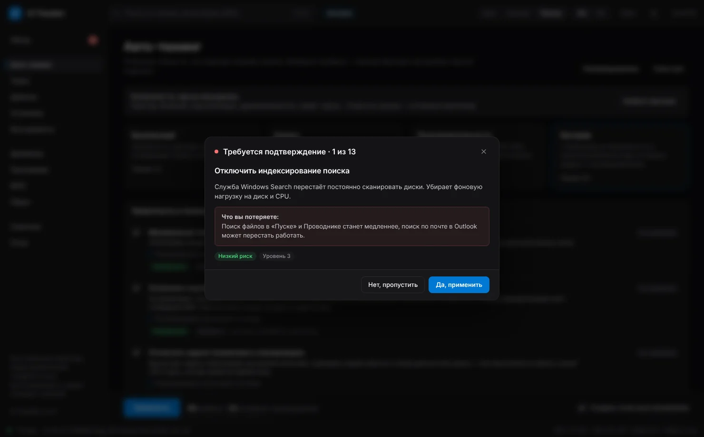
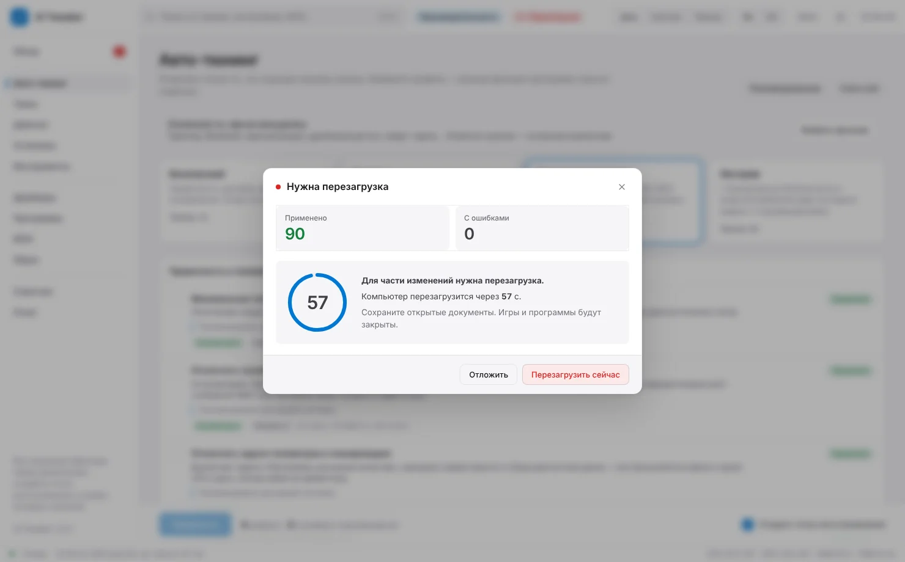
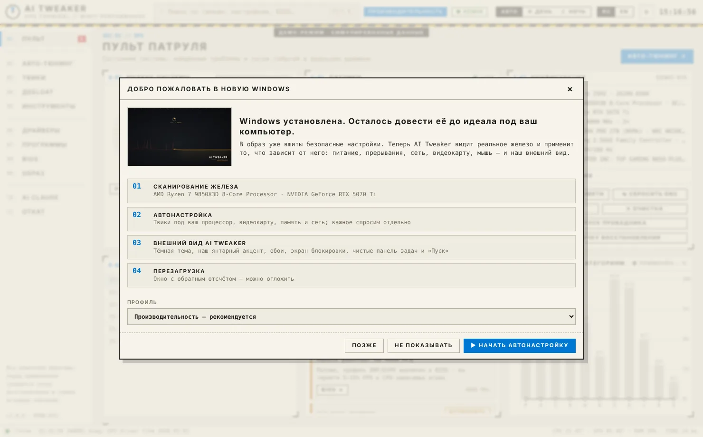
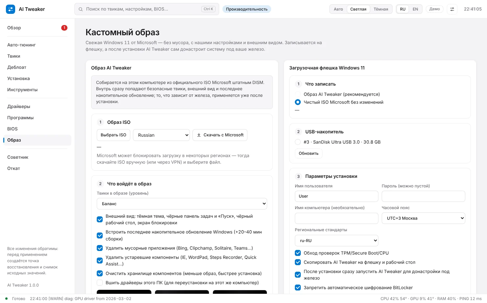
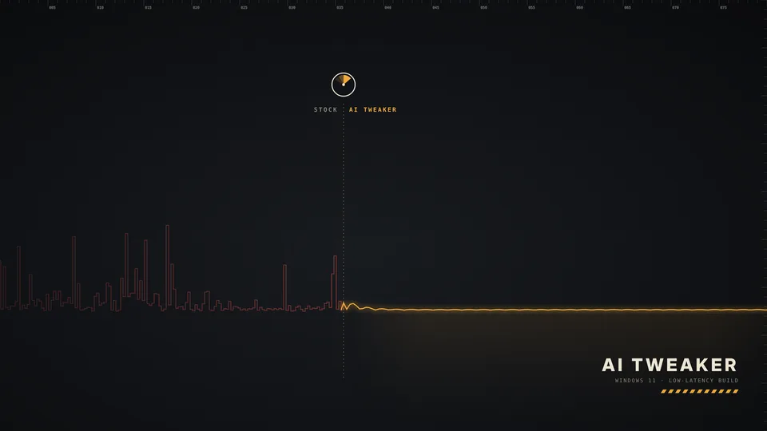
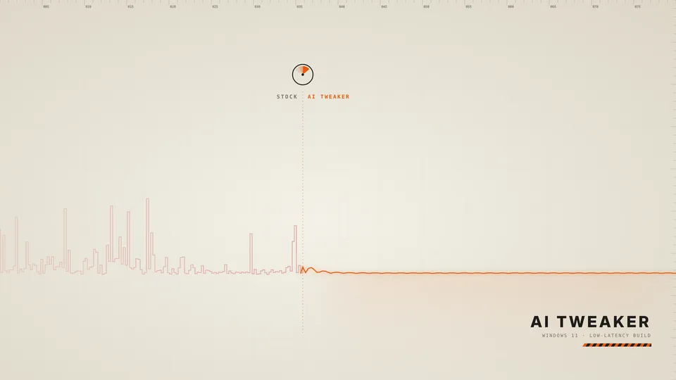

# AI Tweaker — OPS TERMINAL

Программа-твикер для Windows 11, которая **сама определяет железо** (CPU Intel/AMD, гибридные P/E-ядра, X3D, видеокарту, память, диски, сеть, ноутбук/ПК, монитор) и применяет **лучшие настройки именно для этой системы**: меньше задержка ввода и кадра, ровнее пинг, больше FPS. Работает только от имени администратора, всё обратимо.



<details><summary>Ещё скриншоты</summary>

| Ночная смена | Подтверждение важных функций |
|---|---|
|  |  |
| **Окно автоматической перезагрузки** | **Первый запуск после установки** |
|  |  |
| **Образ AI Tweaker** | **Настройки программ (по скриншотам мастера)** |
|  |  |

</details>

## Что умеет

| Раздел | Что делает |
|---|---|
| **01 Пульт** | Индекс готовности системы (задержка, FPS, приватность, чистота), температуры CPU/GPU/NVMe, загрузка и вентилятор GPU, разрешение таймера, живой поток событий, тикеты найденных проблем, карта оптимизаций, мониторинг, экспорт отчёта |
| **02 Авто-тюнинг** | 4 профиля (Безопасный → Экстрим). Локальный AI-движок отмечает только подходящие вашему железу твики и объясняет «почему» |
| **03 Твики** | Каталог из 95+ твиков: приватность, игры, мышь/клавиатура, сеть, питание, устройства и прерывания, службы, интерфейс, **внешний вид AI Tweaker**, программы, безопасность. Статус каждого, применение и откат по одному |
| **04 Деблоат** | Удаление встроенных приложений Windows для всех пользователей. Store, Xbox, «Связь с телефоном», Outlook и т. п. никогда не выбраны заранее и требуют подтверждения |
| **05 Инструменты** | Тест пинга/джиттера/потерь до игровых серверов, сброс DNS и сетевого стека, очистка standby-памяти, автозагрузка, очистка временных файлов и кэшей шейдеров, перезапуск Проводника |
| **06 Драйверы** | Видеокарта, чипсет, сеть, устройства без драйверов, возраст драйвера, официальные ссылки |
| **07 Программы** | Discord, Steam, NVIDIA App, AMD Adrenalin, OBS, Spotify, Epic Games, ExitLag — значения всех переключателей и скриншоты из папки мастера; NVIDIA Control Panel и Windows — рекомендации AI Tweaker |
| **08 BIOS** | Советы под вашу плату (ASUS / MSI / Gigabyte / ASRock) с точным путём в меню: XMP/EXPO, ReBAR, Secure Boot, TPM, микрокод Intel 13/14, PBO… Кнопка «Перезагрузить в BIOS» |
| **09 Образ** | **Собственный образ AI Tweaker** из официального ISO Microsoft + загрузочная флешка с `autounattend.xml` (подробнее ниже) |
| **10 AI Claude** | Необязательно: Claude анализирует профиль ПК и советует, что применить и чего избегать. Выбирает **только из каталога** — никаких произвольных команд |
| **11 Откат** | Каждый твик хранит исходные значения Windows; откат одного твика или всего сразу, точки восстановления, история сеансов |

Поиск по всему (твики, настройки программ, пункты BIOS, приложения): **Ctrl + K**. Интерфейс на русском и английском. Цвет интерфейса берётся из акцентного цвета Windows, светлая/тёмная тема — по системной (или вручную).

Если после твиков нужна перезагрузка или повторный вход, появляется **окно автоматической перезагрузки** с обратным отсчётом (по умолчанию 60 с, настраивается или отключается). Её можно отложить — тогда в шапке горит «⟳ Перезагрузка», пока Windows действительно не перезапустится.

### Образ AI Tweaker — сделан с нуля, без чужих сборок

1. **Свежая Windows 11** — ISO последней версии скачивается напрямую с Microsoft (или выберите свой).
2. **Сборка на вашем ПК средствами DISM**: из ISO берётся редакция Pro, в неё встраивается **последнее накопительное обновление** из официального Microsoft Update Catalog, удаляются мусорные приложения и устаревшие компоненты, в реестр образа вшиваются безопасные твики (приватность, реклама, ввод, службы…) и **внешний вид AI Tweaker**, хранилище компонентов очищается. По желанию — драйверы этого ПК.
3. **Флешка** с `autounattend.xml`: локальная учётная запись, без экранов Microsoft, обход проверок TPM, без автошифрования BitLocker.
4. **После установки AI Tweaker запускается сам**, сканирует реальное железо и применяет то, что от него зависит (питание, прерывания, сеть, GPU, монитор), — затем окно перезагрузки.

Твики, зависящие от железа, в образ намеренно не вшиваются: их нельзя правильно выбрать, не видя компьютер. Перед сборкой кнопка «Что будет в образе» показывает точный список.

### Внешний вид AI Tweaker

Собственное оформление Windows: тёмная тема, фирменный акцент «сигнальный янтарь» (с полной палитрой оттенков), **наши обои в 4K** (график времени кадра: рваный «до» — ровный «после») и экран блокировки, чистая панель задач, «Пуск» без рекомендаций, «Этот компьютер» на рабочем столе. Файлы оформления лежат в `C:\ProgramData\AITweaker\Look`; тема `AI Tweaker` по возможности добавляется и в «Параметры → Персонализация → Темы». Обои рисуются нашим скриптом `tools/wallpapers/make.py` — никаких чужих картинок.

| Рабочий стол | Экран блокировки | Светлый вариант |
|---|---|---|
|  |  |  |

### Что программа учитывает в железе (примеры)

- **Ryzen X3D с двумя чиплетами** (7950X3D, 9950X3D…): оставляет сбалансированную схему питания, парковку ядер и Xbox Game Bar — без них драйвер AMD не отправит игру на ядра с 3D V-Cache.
- **Гибридные Intel (P/E)**: прерывания GPU/сети/USB закрепляются только за P-ядрами, Power Throttling не трогается.
- **Intel 13/14 gen**: проверяет микрокод (защита от деградации Vmin Shift, нужен 0x12B+).
- **Ноутбук**: питание меняется только «от сети», схема производителя сохраняется, без отключения динамического тика и гибернации.
- **Монитор на 60 Гц вместо 144/165/240**: находит и исправляет.
- **Память на JEDEC-частоте** (XMP/EXPO выключен), одна планка, HDD под системой, старый драйвер видеокарты, HVCI/VBS, отсутствие Secure Boot/TPM для античитов.
- **Виртуальная машина**: аппаратные твики пропускаются.

## Безопасность

- Перед применением — точка восстановления Windows (можно отключить).
- Для каждого твика сохраняется **исходное** состояние (реестр, службы, задачи, питание, BCD, устройства, мониторы) в `C:\ProgramData\AITweaker\backups`. Повторное применение не перезаписывает оригинал.
- Твики, которые отключают что-то важное, спрашивают отдельно и объясняют, что вы потеряете. Высокорисковые твики (Spectre/Meltdown, VBS) — только с подтверждением, некоторые только вручную.
- Образ: сборка идёт в отдельной папке `C:\ProgramData\AITweaker\image`, исходный ISO не меняется; при ошибке смонтированный образ отбрасывается.
- Флешка: стираются только диски с шиной USB, нужно ввести номер диска; разметка диска при установке Windows **не** автоматизирована.
- Логи: `C:\ProgramData\AITweaker\logs`.

## Скачать

- **Готовая сборка**: вкладка **Actions** → последний запуск **Build** → артефакт **AITweaker-win-x64** (внутри `AITweaker.exe`).
- **Релизы**: при пуше тега `v*` exe прикрепляется к GitHub Release.

Требования: Windows 10 2004+ / Windows 11 x64, права администратора, WebView2 Runtime (встроен в Windows 11). .NET устанавливать не нужно — exe автономный.

## Сборка из исходников

```bash
dotnet test tests/AITweaker.Core.Tests          # тесты движка и каталога (работают и на Linux)
dotnet publish src/AITweaker.App -c Release -o publish   # → publish/AITweaker.exe
```

Нужен .NET 10 SDK. Собрать Windows-приложение можно и на Linux/macOS (`EnableWindowsTargeting`), запускать — только на Windows.

Интерфейс можно открыть в обычном браузере (`src/AITweaker.App/wwwroot/index.html`) — он запустится в **демо-режиме** со встроенными симулированными данными.

## Устройство проекта

```
src/AITweaker.Core/        .NET 10, без зависимостей от Windows
  Data/tweaks/*.json       каталог твиков (RU/EN, условия, уровни, риски)
  Data/apps.json           встроенные приложения для удаления
  Data/guides.json         настройки программ
  Data/bios.json           советы по BIOS с путями для каждого производителя плат
  Conditions/              язык условий: "gpu.nvidia && !system.laptop && ram.gb >= 16"
  Engine/                  движок рекомендаций, диагностика (тикеты)
  Affinity/                выбор ядер для прерываний
  Data/tweaks/11-look.json внешний вид AI Tweaker (тема, акцент, обои, панель задач)
  Image/                   план офлайн-образа, внешний вид, разбор Update Catalog, autounattend.xml
  Ai/                      советник на Claude (официальный Anthropic SDK)
src/AITweaker.App/         WinForms + WebView2, requireAdministrator
  Platform/                WMI-сканер, обработчики действий, бэкапы/откат, сборщик образа (DISM), USB, датчики
  Assets/Wallpapers/       обои AI Tweaker 4K (встраиваются в exe)
  Bridge/                  JSON-RPC между интерфейсом и C#
  wwwroot/                 интерфейс OPS TERMINAL (HTML/CSS/JS без внешних зависимостей)
tests/AITweaker.Core.Tests/ xUnit: движок, условия, каталог, офлайн-образ, внешний вид, unattend, прерывания
tools/gen-mock-data.py     обновляет данные демо-режима из каталога
tools/wallpapers/          генератор наших обоев (SVG → JPG/WebP)
```

### Как добавить твик

Добавьте объект в нужный `src/AITweaker.Core/Data/tweaks/*.json`:

```json
{
  "id": "gaming.example",
  "category": "gaming",
  "level": 2,
  "when": "gpu.nvidia && system.desktop",
  "name": { "ru": "Название", "en": "Name" },
  "description": { "ru": "Что и зачем", "en": "What and why" },
  "actions": [
    { "type": "registry", "path": "HKLM\\SOFTWARE\\…", "name": "Value", "kind": "dword", "value": 1 }
  ]
}
```

Типы действий: `registry` (с `*` в пути для всех подключей), `service`, `task`, `powercfg`, `powerScheme`, `bcd`, `command`, `powershell`, `device`, `nic`, `msi`, `affinity`, `directx`, `appx`, `display`, `wallpaper`. Если твик отключает что-то, чем пользуются, — `"confirm": true` и `confirmText`. Тесты проверят каталог: уникальность id, известные факты в условиях, корректность значений и т. д. После изменений запустите `python3 tools/gen-mock-data.py`.

## Тестирование на Windows

Пошаговый гайд по виртуальной машине для безопасной проверки — [docs/WINDOWS_VM_SETUP.md](docs/WINDOWS_VM_SETUP.md).

## Сторонние инструменты

Чужих сборок Windows, плейбуков и твикеров AI Tweaker не использует: образ собирается из официального ISO Microsoft штатным DISM, обновления берутся из Microsoft Update Catalog. Для получения ссылки на ISO используется скрипт Fido (pbatard/Fido) — он только запрашивает ссылку у Microsoft. AI-консультант использует ваш собственный API-ключ Claude; ключ хранится локально, зашифрованным DPAPI.
