# AI Tweaker

Настройка Windows 11 под ваш компьютер. Программа сама определяет железо — процессор (Intel/AMD, гибридные P/E-ядра, X3D), видеокарту, память, диски, сеть, монитор, ноутбук или ПК — и применяет то, что подходит именно этой системе: меньше задержка ввода и кадра, ровнее пинг, больше FPS. Всё, что отключает нужное, спрашивается отдельно. Всё обратимо.

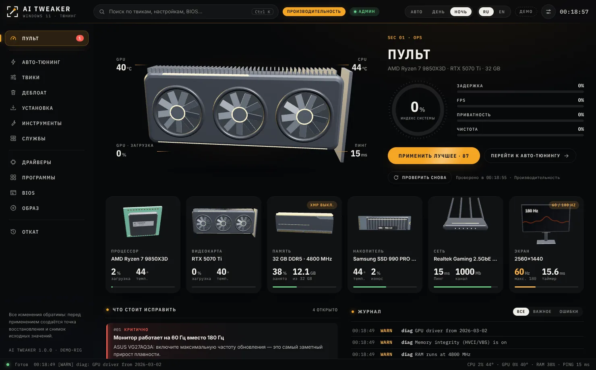

<details><summary>Ещё скриншоты</summary>

| Дневная смена | Применение твиков |
|---|---|
| 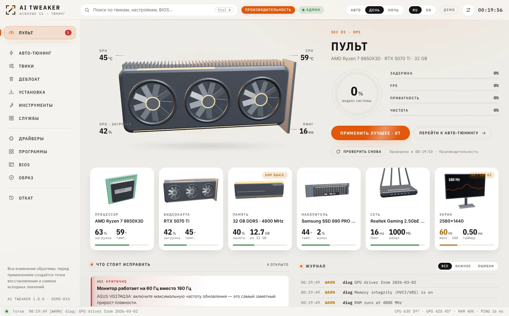 | 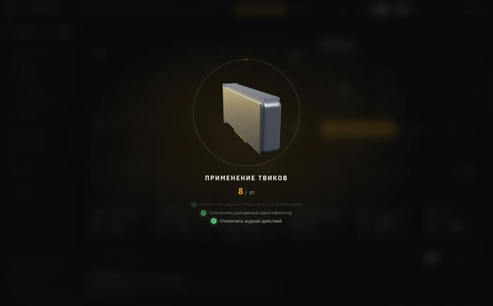 |
| **Драйвер NVIDIA и его настройки** | **Переустановка без флешки** |
| 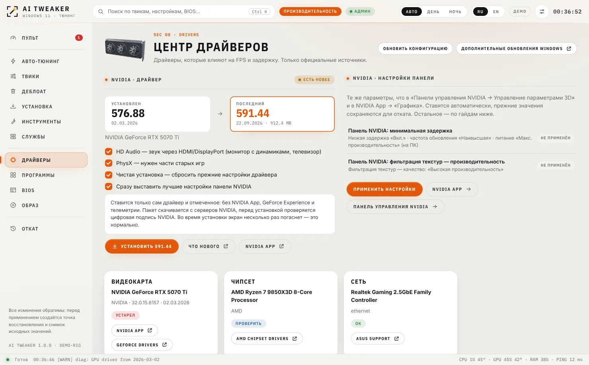 | 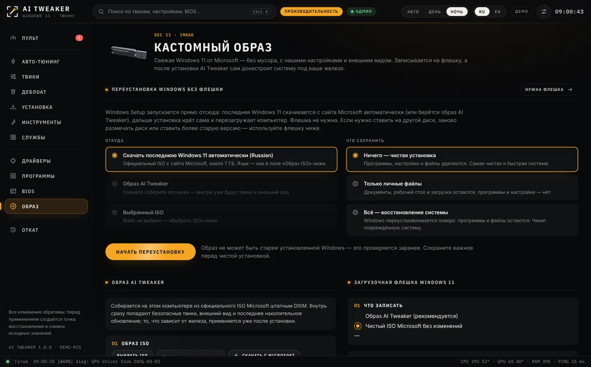 |
| **NVIDIA App: что и где выставить** | **Discord: окно настроек нарисовано рядом** |
| 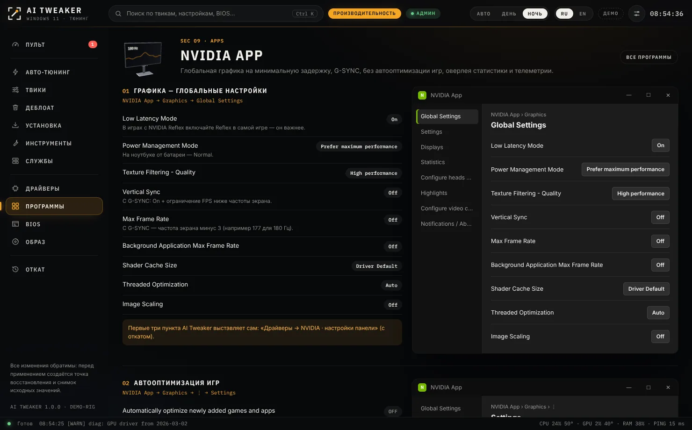 | 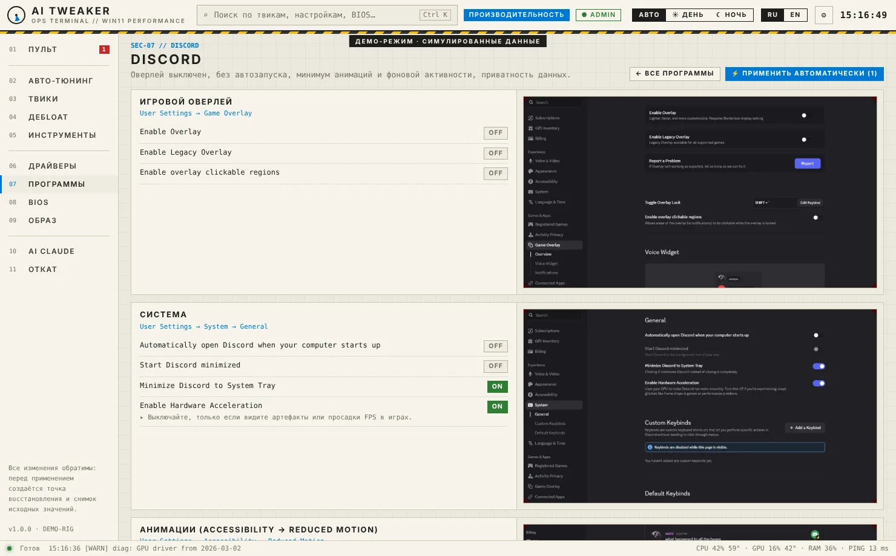 |
| **Каталог твиков** | **Чем вы пользуетесь?** |
| 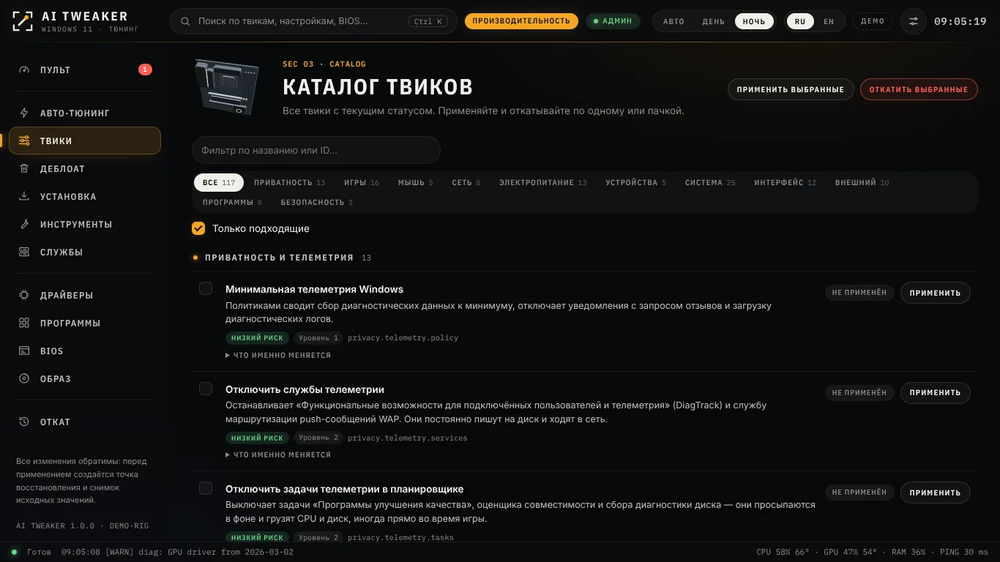 | 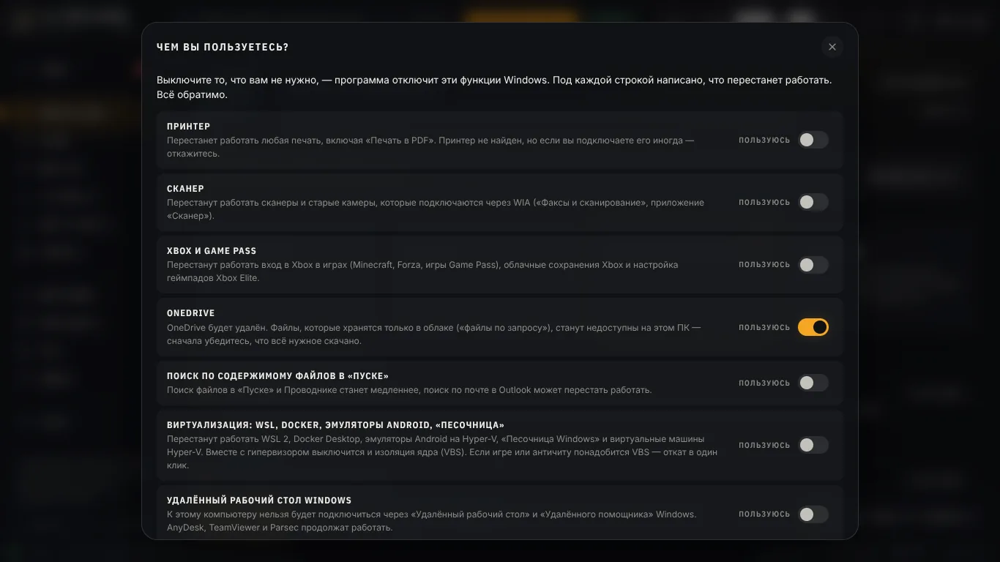 |
| **Установка программ** | **Инструменты: сеть, DNS, разрешение экрана** |
| 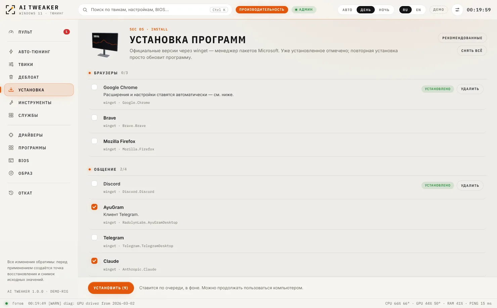 | 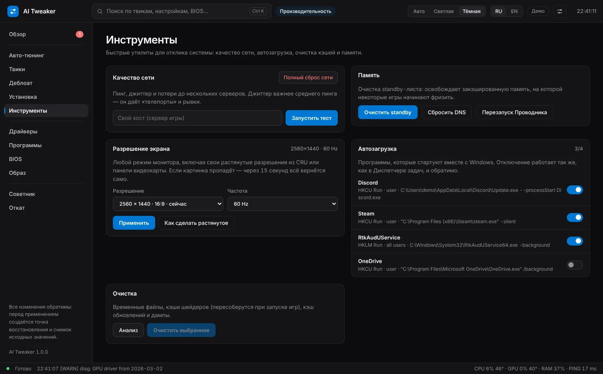 |
| **Службы Windows** | |
| 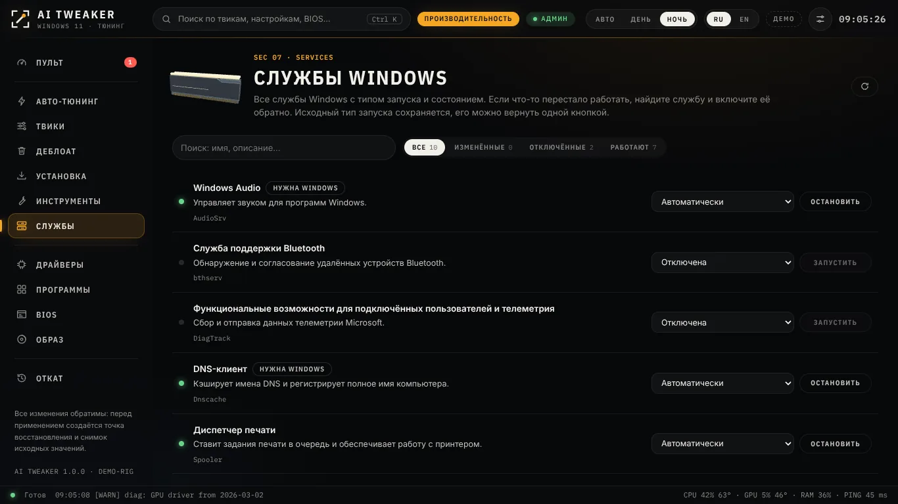 | |

</details>

## Разделы

| Раздел | Что делает |
|---|---|
| **Обзор** | Живые 3D-модели комплектующих вашего ПК (вентиляторы и подсветка следуют реальной нагрузке, модели крутятся мышкой) с датчиками: температуры CPU/GPU/NVMe, загрузка, частота экрана, пинг. Индекс системы, кнопка «Применить лучшее», найденные проблемы, журнал, быстрые действия |
| **Оптимизация** | Один режим вместо профилей: всё, что подходит вашему железу, ради максимума FPS, минимума задержки и лучшего пинга. Отключает телеметрию, фоновые службы и приложения, рекламу, лишние функции Windows и встроенный мусор, настраивает установленные программы. Каждое важное отключение — отдельный вопрос с двумя сторонами: «Если отключить» (что даст и что потеряете) и «Если оставить». **Ваши игры**: игры из Steam и Epic находятся сами (или добавляются по .exe) и получают сетевой приоритет QoS (DSCP 46), а на ПК с двумя видеокартами — дискретную; высокий приоритет процессора — по желанию. Каталог сверен с PC-Tuning, AtlasOS/ReviOS, WinUtil, скриптами FR33THY, исследованиями djdallmann и Blur Busters (и с тем, что продают платные твикеры — плацебо не берём): то, что по замерам не работает (NetworkThrottlingIndex, задача MMCSS «Games», TCPNoDelay, svchost split), переведено в ручные с честным описанием |
| **Игровой режим** | Кнопка в верхней панели: на время игры ставит на паузу обновления (Windows Update, Store, Edge/Chrome), индексацию и SysMain, телеметрию, печать, закрывает фоновые программы (OneDrive, Teams, виджеты…), выключает фоновый поиск сетей Wi-Fi (главную причину периодических скачков пинга по Wi-Fi), включает питание на максимум, очищает кэш памяти и держит таймер 0,5 мс. Выключили или закрыли программу — всё вернулось. Защитник Windows и службы безопасности не трогаются |
| **Твики** | Каталог из 138 твиков: приватность, игры, мышь и клавиатура, сеть, питание, устройства и прерывания, службы, интерфейс, внешний вид, программы, безопасность. Статус, применение и откат по одному |
| **Деблоат** | Удаление встроенных приложений для всех пользователей. Store, Xbox, «Связь с телефоном», Outlook заранее не выбраны и требуют подтверждения. Удалённые можно **вернуть** одной кнопкой |
| **Софт** | Официальные установщики прямо с сайтов производителей (или их GitHub), с проверкой цифровой подписи, одной очередью, тихо где можно: Chrome, Discord, AyuGram, Telegram, Steam, Epic, EA app, Spotify, OBS, mpv, Lightshot, 7-Zip, библиотеки Visual C++/DirectX/.NET, Open-Shell и CRU. От Microsoft Store ничего не зависит. Уже установленное отмечено, его можно удалить. Расширения Chrome |
| **Инструменты** | Пинг, джиттер и потери до игровых серверов, **выбор DNS с проверкой скорости**, сброс сети, очистка standby-памяти, **автозагрузка с подсказками** (лишнее — лаунчеры, обновлялки, трей-помощники — отключается одной кнопкой, драйверы звука, мыши, античиты и защита помечены как важные; для полного контроля — Autoruns от Microsoft с инструкцией), очистка временных файлов и кэшей шейдеров, **разрешение и частота экрана** |
| **Замеры** | Цифры до и после вместо «вроде плавнее». **Система в простое** (10 с): нагрузка CPU, время в DPC и прерываниях, переключения контекста, процессы, службы, автозагрузка, занятая память, точность Sleep(1) при таймере 1 мс, пинг и джиттер до роутера (качество Wi-Fi) и до интернета, время загрузки Windows. Первый замер «до» делается сам перед первой оптимизацией. **В игре** — Intel PresentMon (скачивается с GitHub, сверяется SHA-256): средний FPS, 1% и 0.1% low, худший фреймтайм, фризы в минуту, задержка до экрана, PC Latency в играх с Reflex и во что упирается FPS — видеокарту или процессор. Первый замер каждой игры сравнивается с последним, изменения в пределах погрешности не считаются |
| **Службы** | Все службы Windows: тип запуска и состояние, поиск, фильтры. Включить, отключить, запустить или остановить любую; исходный тип запуска возвращается одной кнопкой |
| **Драйверы** | **NVIDIA**: последний драйвер именно для вашей карты с сайта NVIDIA, проверка подписи и тихая чистая установка без лишнего (только драйвер + HD Audio и PhysX по желанию), затем автоматически — лучшие настройки панели NVIDIA с откатом. Остальное — по каждому компоненту: программа читает производителя чипа (по ID устройства), версию, дату и кто писал драйвер, и даёт правильный источник: Intel — через Intel DSA (Killer — обычный драйвер Intel без Killer Control Center), AMD — драйвер чипсета (на двухчиплетных X3D — критично), Realtek / MediaTek / Qualcomm — с сайта производителя ПК или платы. Отмечает базовый драйвер Windows и старые версии; первая карточка — страница драйверов под вашу модель |
| **Конфиги софта** | Для основных программ (NVIDIA App, AMD Adrenalin, Discord, Steam, Epic, OBS, Spotify) — настоящие скриншоты экранов настроек рядом с каждым разделом (клик — во весь размер) и два блока: «Сделает AI Tweaker» — настройки, которые программа меняет сама и откатывает (автозапуск Discord и Spotify прямо в их файлах настроек, политики Chrome, глобальные настройки NVIDIA…), и «Вручную в программе» — что выставить в самой программе по шагам. Кнопка «Настроить все установленные» **OBS** настраивается сам, если он закрыт: стрим NVENC H.264 CBR 6000 Кбит/с в 1664×936 при 60 FPS, запись NVENC AV1 на RTX 40/50 (HEVC на остальных) CQP 18 в Hybrid MP4, Replay Buffer 30 с, звук 48 кГц / AAC 160; ключи сверены с исходниками OBS. **Spotify** — качество «Очень высокое» без автоподстройки |
| **Ручная настройка** | Всё, что программа не может сделать за вас, по разделам: **BIOS** (путь в меню под вашу плату или ноутбук: ASUS, MSI, Gigabyte, ASRock, Lenovo, HP, Dell/Alienware, Acer, Razer, Surface; клавиши входа и сохранения, перезагрузка прямо в BIOS; на ПК — XMP/EXPO, ReBAR, Secure Boot, TPM, микрокод Intel 13/14, PBO; на ноутбуке — режим «Производительность» и видеокарта напрямую через MUX в утилите производителя), **видеокарта** (NVIDIA App / AMD Software, G-SYNC/FreeSync), **в играх** (Reflex / Anti-Lag 2, лимит кадров, графика, оверлеи), **Windows** («Не беспокоить», обновления, «Безопасность Windows»), **железо** (монитор, мышь, кабель). Отмечайте сделанное — прогресс сохраняется, а что уже включено, программа видит сама |
| **Образ** | **Переустановка без флешки**: последняя Windows 11 скачивается с сайта Microsoft сама, Windows Setup запускается прямо из системы — чистая установка, только файлы или восстановление с сохранением всего. Собственный образ из официального ISO, загрузочная флешка, **Rufus** (скачивается и открывается одной кнопкой), плейбук для AME Wizard |
| **Откат** | Исходные значения Windows для каждого твика, откат по одному или всего сразу, точки восстановления, история |

Поиск по всему — **Ctrl + K**. Русский и английский. Дневная и ночная смена — как в Windows или вручную; акцент — сигнальный оранжевый, цвет Windows или монохром.

## Вернуть или включить что угодно

- **Твик** — «Откат» → твик → «Откатить» (или всё сразу). Возвращаются исходные значения Windows, сохранённые перед изменением.
- **Служба** — «Службы» → найти по имени → выбрать тип запуска и «Запустить». Если её отключил твик, рядом ссылка на его откат.
- **Встроенное приложение** — «Деблоат» → «Удалённые — можно вернуть» → «Вернуть» (Store возвращается штатной командой Windows, остальное — из Microsoft Store).
- **Программа** — «Установка»: поставить или удалить одной кнопкой.
- **Всё сразу** — точка восстановления Windows, которая создаётся перед изменениями.

Если после изменений нужна перезагрузка, появляется окно с обратным отсчётом (60 с по умолчанию, настраивается или отключается). Её можно отложить — в шапке останется напоминание, пока Windows действительно не перезапустится.

## Отключите то, чем не пользуетесь

Одно окно со списком функций Windows: принтер, сканер, Bluetooth, Xbox, OneDrive, поиск по содержимому файлов, виртуализация (Hyper-V, WSL), удалённый рабочий стол, Windows Hello, смарт-карты и токены ЭЦП, местоположение, звонки через «Связь с телефоном», раздача Wi-Fi, фоновые приложения Store, изоляция ядра. Под каждой строкой написано, что перестанет работать. То, чем вы явно пользуетесь (например, найден принтер или Bluetooth), отмечено заранее; изоляция ядра по умолчанию остаётся включённой.

Как отключить Hyper-V вручную и проверить результат — [docs/HYPER-V.md](docs/HYPER-V.md).

## Внешний вид

Тёмная тема, чёрные панель задач и «Пуск», сплошной чёрный рабочий стол, спокойный экран блокировки, значки на панели задач слева, «Пуск» без рекомендаций, «Этот компьютер» на рабочем столе. Акцент монохромный — переключатели и выделение светло-серые, чтобы их было хорошо видно.

- **Классический «Пуск» в стиле Windows 7** — через бесплатный [Open-Shell](https://github.com/Open-Shell/Open-Shell-Menu): слева программы и поиск, справа «Загрузки», «Этот компьютер», раскрывающаяся «Панель управления» и «Параметры». Ставится на вкладке «Установка» (только сам «Пуск», без панели Проводника), затем AI Tweaker настраивает его сам.
- **StartAllBack** — платная альтернатива: на вкладке «Установка» ставится официальный установщик с пробным периодом, лицензия покупается у автора. Настройки под вид AI Tweaker — в разделе «Программы».
- Вместо чёрного фона можно выбрать наши минималистичные обои; файлы оформления лежат в `C:\ProgramData\AITweaker\Look`.

| Обои «Графит» | Обои «Обсидиан» | Экран блокировки |
|---|---|---|
|  |  | 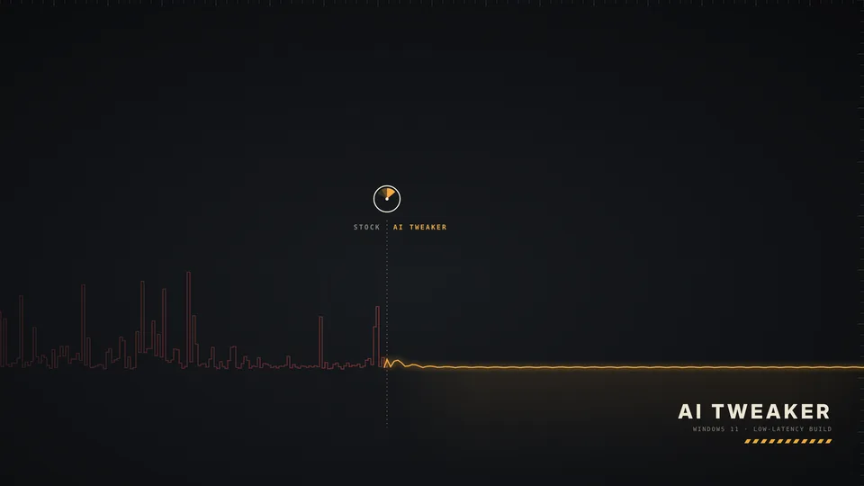 |

## Программы и Chrome

Вкладка «Установка» ставит выбранные программы из официального репозитория Microsoft (winget) одной очередью; если winget сломан, программа его восстанавливает. Для Chrome — политика, которая сама ставит расширения из Chrome Web Store: **uBlock Origin Lite**, **SponsorBlock** (6.1.6+), **DeepL** (1.103.0+), **Volume Master** (2.4.0+), — и настройки приватности (без Privacy Sandbox, рекламных тем и отчётов). Выключить любое расширение можно в `chrome://extensions`.

## Растянутое разрешение

[CRU](https://www.monitortests.com/forum/Thread-Custom-Resolution-Utility-CRU) скачивается на вкладке «Установка» — дальше настраиваете сами. Переключать режимы удобно в «Инструменты → Разрешение экрана»: список всех режимов с соотношением сторон, а если монитор не покажет новый режим, через 15 секунд вернётся прежний.

## Образ Windows, флешка и Rufus

1. **Свежая Windows 11** — ISO скачивается напрямую с Microsoft (или выберите свой).
2. **Сборка на вашем ПК штатным DISM**: редакция Pro, последнее накопительное обновление из Microsoft Update Catalog, без мусорных приложений и устаревших компонентов, с безопасными твиками и внешним видом AI Tweaker. По желанию — драйверы этого ПК.
3. **Флешка** с `autounattend.xml`: локальная учётная запись, без экранов Microsoft, обход проверок TPM, без автошифрования BitLocker.
4. **После установки AI Tweaker запускается сам**, сканирует железо и применяет то, что от него зависит, — затем окно перезагрузки.

Твики, зависящие от железа, в образ не вшиваются: их нельзя выбрать правильно, не видя компьютер. Кнопка «Что будет в образе» показывает точный список.

Обычный ISO Microsoft можно записать и через **Rufus**: кнопка «Открыть Rufus» скачивает официальную версию с GitHub автора (подпись проверяется) и открывает её с уже выбранным ISO, дальше вы настраиваете сами. Потом AI Tweaker одной кнопкой копирует себя на готовую флешку.

## Плейбук для AME Wizard

«Образ → Плейбук для AME Wizard» сохраняет на рабочий стол `AI Tweaker.apbx`: внешний вид, классический «Пуск» и отключение ненужного — из того же каталога, что применяет программа. В AME Wizard на отдельных страницах выбирается «Пуск» и отмечается, что отключить. Первым шагом плейбук создаёт точку восстановления. Файл собирается самой программой, никаких чужих плейбуков.

## Что учитывается в железе

- **Ryzen X3D с двумя чиплетами** (7950X3D, 9950X3D…): остаются сбалансированная схема питания, парковка ядер и Xbox Game Bar — без них драйвер AMD не отправит игру на ядра с 3D V-Cache.
- **Гибридные Intel (P/E)**: прерывания GPU, сети и USB закрепляются за P-ядрами, Power Throttling не трогается.
- **Intel 13/14 gen**: проверка микрокода (защита от деградации Vmin Shift, нужен 0x12B+).
- **Ноутбук**: питание меняется только «от сети», схема производителя сохраняется.
- **Монитор на 60 Гц вместо 144/165/240**: находит и исправляет.
- **Память на JEDEC-частоте** (XMP/EXPO выключен), одна планка, HDD под системой, старый драйвер видеокарты, нет Secure Boot/TPM для античитов.
- **Виртуальная машина**: аппаратные твики пропускаются.

## Безопасность

- Перед применением — точка восстановления Windows (можно отключить).
- Для каждого твика сохраняется **исходное** состояние (реестр, службы, задачи, питание, BCD, устройства, мониторы) в `C:\ProgramData\AITweaker\backups`. Повторное применение не перезаписывает оригинал.
- Твики, отключающие важное, спрашивают отдельно и объясняют, что вы потеряете. Защиту Windows (антивирус, UAC, SmartScreen, брандмауэр, целостность памяти, защиту от Spectre/Meltdown) программа не выключает — это проверяет тест.
- Образ собирается в отдельной папке, исходный ISO не меняется. Флешка: стираются только USB-диски и только после ввода номера диска; разметка диска при установке Windows не автоматизирована.
- Логи: `C:\ProgramData\AITweaker\logs`.

Как проверить всё на своём компьютере без виртуальной машины и как откатиться — [docs/TESTING.md](docs/TESTING.md).

## Скачать

- **Релизы**: [последняя версия](https://github.com/sethosint/ai-tweaker/releases/latest) → **AITweaker.exe** в блоке Assets. Установка не нужна — это один файл; при первом запуске Windows может предупредить о неизвестном издателе: «Подробнее» → «Выполнить в любом случае».
- **Сборка с каждого коммита**: вкладка **Actions** → запуск **Build** → артефакт **AITweaker-win-x64**.

Требования: Windows 10 2004+ / Windows 11 x64, права администратора, WebView2 Runtime (есть в Windows 11). .NET ставить не нужно — exe автономный.

## Сборка из исходников

```bash
dotnet test tests/AITweaker.Core.Tests                    # тесты движка и каталога (работают и на Linux)
dotnet publish src/AITweaker.App -c Release -o publish    # → publish/AITweaker.exe
```

Нужен .NET 10 SDK. Собрать Windows-приложение можно и на Linux/macOS (`EnableWindowsTargeting`), запускать — только на Windows.

Интерфейс можно открыть в обычном браузере (`src/AITweaker.App/wwwroot/index.html`) — он запустится в **демо-режиме** с симулированными данными.

## Устройство проекта

```
src/AITweaker.Core/            .NET 10, без зависимостей от Windows
  Data/tweaks/*.json           каталог твиков (RU/EN, условия, уровни, риски)
  Data/features.json           «Чем вы пользуетесь?» — функции и их твики
  Data/programs.json           программы для установки (winget)
  Data/extensions.json         расширения Chrome
  Data/apps.json               встроенные приложения для удаления
  Data/guides.json             настройки программ (NVIDIA App, AMD Software, Discord, Steam, Epic, OBS, Spotify)
  tools/guide-shots/build.py   нарезка скриншотов настроек в wwwroot/guides, личные данные размываются
  Data/bios.json               советы по BIOS с путями для каждого производителя
  Data/vendors.json            производители плат и ноутбуков: вход в BIOS, сайт драйверов, утилиты
  Conditions/                  язык условий: "gpu.nvidia && !system.laptop && ram.gb >= 16"
  Engine/                      движок рекомендаций, диагностика
  Affinity/                    выбор ядер для прерываний
  Image/                       офлайн-образ, внешний вид, Update Catalog, autounattend.xml, плейбук AME
src/AITweaker.App/             WinForms + WebView2, requireAdministrator
  Platform/                    сканер железа, действия, бэкапы и откат, сборка образа (DISM), USB, winget, режимы экрана
  Assets/                      обои, экран блокировки и логотип плейбука (встраиваются в exe)
  Bridge/                      JSON-RPC между интерфейсом и C#
  wwwroot/                     интерфейс (HTML/CSS/JS без внешних зависимостей)
tests/AITweaker.Core.Tests/    xUnit: движок, условия, каталог, образ, внешний вид, плейбук AME, unattend, прерывания
tools/gen-mock-data.py         обновляет данные демо-режима из каталога
tools/wallpapers/make.py       генератор обоев
tools/brand/                   логотип плейбука
```

### Как добавить твик

Добавьте объект в нужный `src/AITweaker.Core/Data/tweaks/*.json`:

```json
{
  "id": "gaming.example",
  "category": "gaming",
  "level": 2,
  "when": "gpu.nvidia && system.desktop",
  "name": { "ru": "Название", "en": "Name" },
  "description": { "ru": "Что и зачем", "en": "What and why" },
  "actions": [
    { "type": "registry", "path": "HKLM\\SOFTWARE\\…", "name": "Value", "kind": "dword", "value": 1 }
  ]
}
```

Типы действий: `registry` (с `*` в пути для всех подключей), `service`, `task`, `powercfg`, `powerScheme`, `bcd`, `command`, `powershell`, `device`, `nic`, `msi`, `affinity`, `directx`, `appx`, `display`, `wallpaper`. Если твик отключает то, чем пользуются, — `"confirm": true` и `confirmText`. Тесты проверяют каталог: уникальность id, известные факты в условиях, корректность значений, откат для PowerShell-действий. После изменений запустите `python3 tools/gen-mock-data.py`.

## Сторонние инструменты

Чужих сборок Windows, плейбуков и твикеров AI Tweaker не использует: образ собирается из официального ISO Microsoft штатным DISM, обновления берутся из Microsoft Update Catalog, программы — из winget. Ссылку на ISO запрашивает скрипт Fido (pbatard/Fido). Open-Shell, CRU, Rufus, StartAllBack и AME Wizard — сторонние программы их авторов; AI Tweaker только ставит официальные версии и настраивает их. Значки программ — Simple Icons (CC0, simpleicons.org; товарные знаки принадлежат их владельцам), собираются скриптом tools/brand-icons.py. Шрифты интерфейса — IBM Plex Sans Condensed и IBM Plex Mono (SIL Open Font License), 3D-модели комплектующих рисуются библиотекой three.js (MIT) прямо в программе, без файлов моделей.
